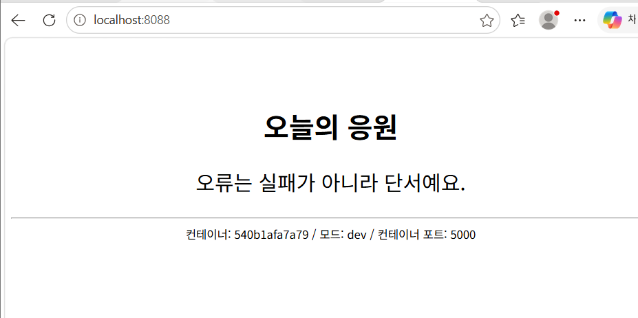
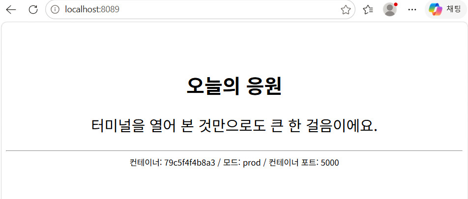
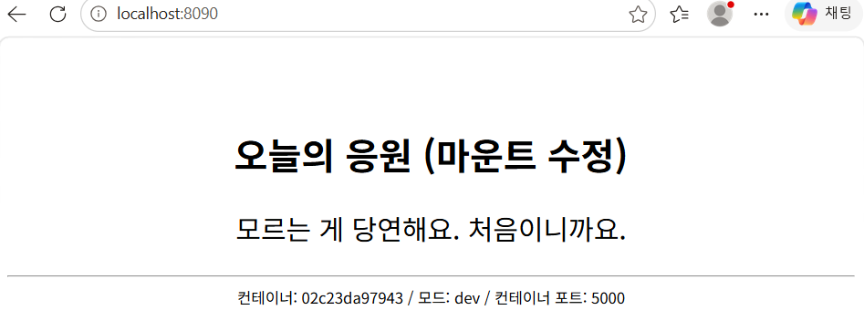

# -
# 🧡 Cheer Up Workstation

천천히 가도 괜찮아요. 멈추지만 않으면 돼요!

## 1. 프로젝트 소개

개발 환경을 직접 구성하고 Linux와 Docker의 기본 기능을 실습하기 위해 만든 프로젝트입니다.

Docker를 활용해 응원 메시지를 보여주는 간단한 웹 서버를 실행하고, 다양한 개발 환경을 경험했습니다.

## 2. 개발 환경

- OS: Windows 11
- Linux: WSL2, Ubuntu
- Container: Docker Desktop
- Language: Python
- Version Control: Git, GitHub

## 3. 터미널 기본 조작

Linux 터미널에서 파일과 폴더를 관리하는 기본 명령어를 실습했습니다.

| 명령어 | 기능 |
|---|---|
| `pwd` | 현재 위치 확인 |
| `ls -la` | 파일 및 폴더 목록 확인 |
| `cd` | 폴더 이동 |
| `mkdir` | 폴더 생성 |
| `touch` | 파일 생성 |
| `cp` | 파일 복사 |
| `mv` | 파일 이동 및 이름 변경 |
| `rm` | 파일 삭제 |
| `cat` | 파일 내용 확인 |

## 4. 파일 권한 실습

Linux의 파일 권한을 변경하고 확인했습니다.

- `chmod`: 파일 권한 변경
- `600`: 소유자 읽기 및 쓰기
- `644`: 소유자 읽기 및 쓰기, 그 외 읽기
- `755`: 소유자 모든 권한, 그 외 읽기 및 실행

## 5. Docker 실습

Docker 설치 여부를 확인하고 컨테이너 실행을 실습했습니다.

- Docker 버전 확인
- `hello-world` 이미지 실행
- Ubuntu 컨테이너 실행
- `attach`와 `exec` 명령어 학습
### Ubuntu 컨테이너 exec 실습

실행 중인 Ubuntu 컨테이너 내부에서 명령어를 실행했습니다.

- `docker exec -it cheer-vol-2 bash`: 컨테이너 내부 접속
- `pwd`: 현재 작업 디렉터리 확인
- `ls /`: 최상위 디렉터리 목록 확인
- `exit`: 컨테이너에서 나가기

실행 결과:
- 현재 위치 `/` 확인
- Ubuntu 최상위 디렉터리 목록 확인
- exec 명령어 실행 성공

## 6. Dockerfile로 이미지 만들기

Dockerfile을 작성하여 나만의 웹 서버 이미지를 만들었습니다.

이미지 이름: `cheer-web:1.0`

주요 명령어:

| 명령어 | 기능 |
|---|---|
| `FROM` | 기본 이미지 지정 |
| `WORKDIR` | 작업 디렉터리 지정 |
| `COPY` | 파일 복사 |
| `ENV` | 환경 변수 설정 |
| `EXPOSE` | 컨테이너 포트 표시 |
| `CMD` | 컨테이너 실행 명령 지정 |

## 7. 포트 매핑 실습

컨테이너의 포트를 컴퓨터의 포트와 연결하여 웹 서버에 접속했습니다.

- 호스트 포트 8088 → 컨테이너 포트 5000
- 호스트 포트 8089 → 컨테이너 포트 5000

브라우저에서 웹 페이지가 정상적으로 열리는 것을 확인했습니다.

## 8. 바인드 마운트 실습

내 컴퓨터의 파일과 컨테이너 내부 파일을 연결했습니다.

호스트에서 파일 내용을 수정한 뒤 컨테이너 내부에도 변경 사항이 반영되는 것을 확인했습니다.

## 9. Docker 볼륨 실습

Docker 볼륨을 사용하여 컨테이너가 삭제되어도 데이터가 유지되는지 확인했습니다.

- 볼륨 이름: `cheer-data`
- 첫 번째 컨테이너에서 데이터 저장
- 첫 번째 컨테이너 삭제
- 두 번째 컨테이너에서 같은 볼륨 연결
- 기존 데이터가 유지되는 것을 확인

## 10. Git과 GitHub

Git을 설정하고 GitHub 저장소와 연결했습니다.

- Git 사용자 설정
- GitHub 저장소 생성
- SSH 인증 확인
- 저장소를 Ubuntu 환경에 복제

## 11. 실습을 통해 배운 점

처음에는 터미널 명령어와 Docker 사용이 낯설었지만 하나씩 직접 입력하고 결과를 확인하면서 개발 환경의 기본 구조를 이해할 수 있었습니다.

특히 컨테이너와 이미지의 차이, 포트 연결, 파일 공유, 볼륨을 통한 데이터 유지 방법을 직접 경험할 수 있었습니다.

앞으로도 새로운 기술을 하나씩 익히며 나만의 개발 작업실을 만들어 가고 싶습니다.

## 12. 실습 결과 스크린샷
### 포트 매핑 실습 (8088 / dev)

### 포트 매핑 실습 (8089 / prod)

### 바인드 마운트 실습 (8090)

---

**천천히 가도 괜찮아요. 멈추지만 않으면 돼요! 🧡**
